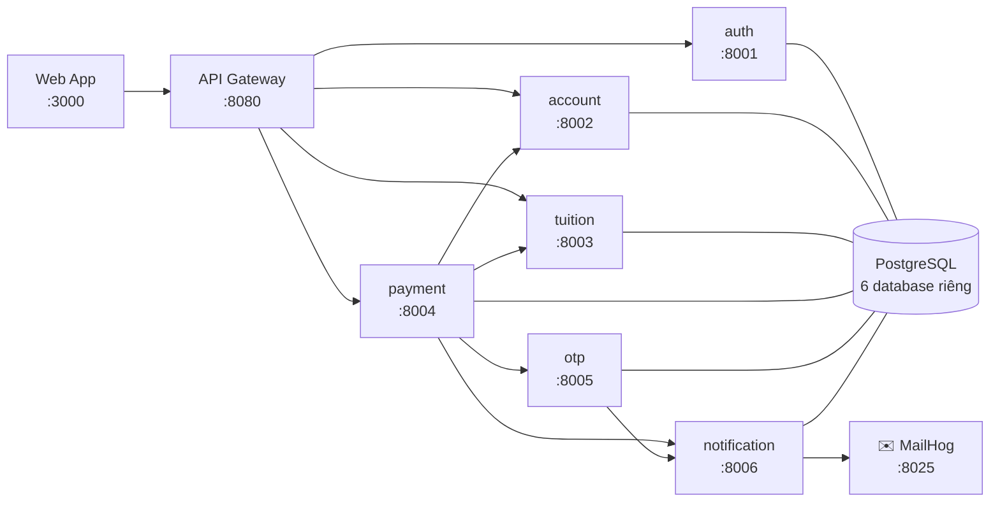

# Phân hệ đóng học phí — iBanking (Microservices)

> **Dự án giữa kỳ — Kiến trúc Hướng Dịch vụ (504070), HK1/2026-2027 — Đại học Tôn Đức Thắng**
> Hệ thống mô phỏng phân hệ thanh toán học phí của ứng dụng iBanking: đăng nhập → tra cứu học phí theo MSSV → thanh toán → xác thực OTP qua email → cập nhật số dư, gạch nợ, lưu lịch sử — có xử lý transaction và concurrency.

| | |
|---|---|
| **Kiến trúc** | 6 microservice + API Gateway, mỗi service một database riêng |
| **Backend** | Python 3.11 · FastAPI · SQLAlchemy 2 · PostgreSQL 16 |
| **Frontend** | Web application (HTML/CSS/JavaScript thuần, phục vụ bởi nginx) |
| **Triển khai** | Docker Compose — 11 container, bao gồm Jaeger |
| **Kiểm thử** | Unit độc lập Docker, integration/E2E, concurrency, phục hồi saga và distributed tracing |

---

## 1. Mục lục tài liệu

| Tài liệu | Nội dung |
|---|---|
| [docs/01-phan-tich-nghiep-vu.md](docs/01-phan-tich-nghiep-vu.md) | Use Case Diagram, đặc tả use case, sơ đồ trạng thái, **ERD**, ràng buộc dữ liệu |
| [docs/02-kien-truc-microservices.md](docs/02-kien-truc-microservices.md) | **Microservices Architecture Diagram**, trách nhiệm từng service, giao tiếp, sequence diagram, giải thích thiết kế |
| [docs/03-thiet-ke-rest-api.md](docs/03-thiet-ke-rest-api.md) | Thiết kế REST API: URI, method, request/response, status code, error code |
| [docs/04-transaction-concurrency.md](docs/04-transaction-concurrency.md) | Cơ chế transaction, saga bù trừ, khoá dòng, hai tình huống đồng thời |
| [docs/05-huong-dan-su-dung-va-demo.md](docs/05-huong-dan-su-dung-va-demo.md) | Hướng dẫn sử dụng, dữ liệu mẫu, kịch bản demo, Q&A bảo vệ |
| [Báo cáo Word](docs/BaoCao_519H0194.docx) · [Báo cáo PDF](docs/BaoCao_519H0194.pdf) | Nguyễn Hoàng Thanh Minh — 519H0194; GVHD Dương Hữu Phúc |

---

## 2. Kiến trúc tổng quan



| Service | Cổng | Trách nhiệm | Database |
|---|---|---|---|
| **api-gateway** | 8080 | Điểm vào duy nhất, định tuyến, xác thực JWT, chặn `/internal/*`, correlation id | — |
| **auth-service** | 8001 | Đăng nhập username/password (bcrypt), phát hành JWT, hồ sơ người dùng | `authdb` |
| **account-service** | 8002 | Số dư khả dụng, trừ/hoàn tiền có khoá dòng, sổ cái giao dịch | `accountdb` |
| **tuition-service** | 8003 | Sinh viên, công nợ học phí, tra cứu theo MSSV, gạch nợ | `tuitiondb` |
| **payment-service** | 8004 | Orchestrator saga: OTP → trừ tiền → gạch nợ → biên lai, bù trừ khi lỗi | `paymentdb` |
| **otp-service** | 8005 | Sinh OTP không trùng, hạn 5 phút, dùng một lần, chặn brute-force | `otpdb` |
| **notification-service** | 8006 | Cổng ra duy nhất tới email (SMTP), template OTP và biên lai | `notificationdb` |

---

## 3. Hướng dẫn cài đặt

### 3.1. Yêu cầu môi trường

| Phần mềm | Phiên bản tối thiểu | Ghi chú |
|---|---|---|
| Docker Desktop (hoặc Docker Engine) | 24+ | Kèm Docker Compose v2 |
| RAM trống | ~3 GB | 11 container, gồm Jaeger |
| Python (chỉ để chạy test) | 3.11 | Khớp runtime Docker và các dependency đã pin |

Các cổng cần trống: `3000`, `8080`, `8001`–`8006`, `5433`, `1025`, `8025`, `16686`. OTLP `4318` chỉ dùng trong mạng Docker.

### 3.2. Cấu hình (tuỳ chọn)

Mọi biến môi trường đều **có giá trị mặc định** nên hệ thống chạy được ngay. Muốn tuỳ chỉnh:

```bash
cp .env.example .env
```

| Biến | Mặc định | Ý nghĩa |
|---|---|---|
| `JWT_SECRET` | `tdtu-soa-midterm-jwt-secret` | Khoá ký JWT |
| `INTERNAL_TOKEN` | `tdtu-soa-internal-token` | Token cho lời gọi service-to-service |
| `OTP_TTL_SECONDS` | `300` | Thời hạn OTP — **5 phút theo đề bài** |
| `OTP_MAX_ATTEMPTS` | `5` | Số lần nhập sai tối đa |
| `LOCK_HOLD_MS` | `150` | Kéo dài thời gian giữ khoá để **quan sát** tranh chấp khi demo; đặt `0` khi đo hiệu năng |
| `RECONCILE_INTERVAL_SECONDS` / `RECONCILE_STUCK_AFTER_SECONDS` | `30` / `60` | Chu kỳ job và tuổi tối thiểu của PROCESSING cần đối soát |
| `OTEL_EXPORTER_OTLP_ENDPOINT` | `http://jaeger:4318` | Nhận span OTLP HTTP nội mạng Docker |
| `SMTP_HOST` / `SMTP_PORT` | `mailhog` / `1025` | Đổi sang SMTP thật nếu muốn gửi mail ra ngoài |

---

## 4. Hướng dẫn khởi chạy

```bash
docker compose up -d --build
```

Lệnh này build 7 image, khởi tạo PostgreSQL với 6 database, nạp dữ liệu mẫu và chờ health check theo đúng thứ tự phụ thuộc. Lần đầu mất khoảng 2–4 phút.

Kiểm tra toàn hệ thống đã sẵn sàng:

```bash
docker compose ps
curl -s http://localhost:8080/health/services
```

```json
{"status":"UP","services":{"auth-service":"UP","account-service":"UP","tuition-service":"UP",
"payment-service":"UP","otp-service":"UP","notification-service":"UP"}}
```

### Các địa chỉ chính

| Thành phần | URL |
|---|---|
| 🖥️ **Giao diện web** | <http://localhost:3000> |
| 🚪 API Gateway | <http://localhost:8080> · [Swagger](http://localhost:8080/docs) · [danh sách service](http://localhost:8080/services) |
| ✉️ **Hộp thư MailHog** (xem email OTP/biên lai) | <http://localhost:8025> |
| 📘 Swagger từng service | <http://localhost:8001/docs> … <http://localhost:8006/docs> |
| 🐘 PostgreSQL | `localhost:5433` — user/password mặc định `ibanking` |
| Jaeger | <http://localhost:16686> — xem trace, quan hệ span và thời gian từng lời gọi |

### Dừng / khởi động lại

```bash
docker compose stop                 # dừng, giữ dữ liệu
docker compose up -d                # chạy lại
docker compose down -v              # xoá sạch, lần chạy sau trở về dữ liệu mẫu ban đầu
docker compose logs -f payment-service
```

---

## 5. Hướng dẫn sử dụng nhanh

**Tài khoản demo** (mật khẩu chung `123456`): `minhnguyen` · `thuha` · `quocbao` · `itdu`
**MSSV demo:** `522H0001` · `522H0002` · `522H0003` · `522H0004` *(đã đóng)* · `522H0005`

1. Mở <http://localhost:3000>, đăng nhập `minhnguyen` / `123456`.
2. Nhập MSSV `522H0001` → **Tra cứu** → hệ thống hiện tên sinh viên và học phí phải đóng.
3. Tick **đồng ý điều khoản** → **Xác nhận giao dịch**.
4. Mở <http://localhost:8025>, lấy **mã OTP 6 chữ số** trong email vừa nhận.
5. Nhập OTP → **Xác nhận** → xem kết quả, số dư mới và biên lai trong MailHog.
6. Tab **Lịch sử giao dịch** để xem giao dịch và biến động số dư.

Chi tiết từng màn hình và kịch bản demo đầy đủ: [docs/05-huong-dan-su-dung-va-demo.md](docs/05-huong-dan-su-dung-va-demo.md).

---

## 6. Kiểm thử tự động

```bash
python3.11 -m venv .venv
./.venv/bin/python3.11 -m pip install -r tests/requirements.txt
./.venv/bin/python3.11 -m pytest tests/unit -v          # không cần Docker
./.venv/bin/python3.11 -m pytest -m unit -v             # chọn theo marker
./.venv/bin/python3.11 -m pytest                       # toàn bộ, cần stack đang chạy
./.venv/bin/python3.11 -m pytest tests/test_03_concurrency.py -v
./.venv/bin/python3.11 -m pytest tests/test_04_reconciliation.py -v
```

Unit test chạy **không cần Docker**, kiểm tra logic thuần và tracing với exporter in-memory. Integration/E2E gọi hệ thống qua API Gateway và **lấy mã OTP từ MailHog**. Các test concurrency/recovery dùng PostgreSQL thật; không dùng mock để chứng minh khóa dòng. Test lỗi saga chèn lỗi phản hồi ở adapter HTTP sau khi thao tác thật đã commit.

Pyramid được phân tầng theo phạm vi, không chỉ số lượng: unit cho phản hồi nhanh; integration cho tương tác dịch vụ và database; E2E cho toàn bộ payment/OTP/email. Không chạy test song song trên các tài khoản demo dùng chung.

| File | Nội dung | Số test |
|---|---|---|
| `tests/test_01_payment_flow.py` | Đăng nhập, phân quyền, tra cứu, luồng thanh toán đầu-cuối, thiếu số dư, học phí đã đóng, idempotency | 11 |
| `tests/test_02_otp.py` | Hạn 5 phút, mã sai, **dùng một lần**, gắn đúng giao dịch, gửi lại mã, khoá sau 5 lần sai, hết hạn | 7 |
| `tests/test_03_concurrency.py` | Hai tình huống đồng thời của đề bài + xác nhận trùng lặp | 3 |
| `tests/unit/` | OTP, JWT, email, quyết định đối soát, OpenTelemetry in-memory | 42 |
| `tests/test_04_reconciliation.py` | Crash recovery, refund, khóa dòng, worker đồng thời, job nền | 15 |
| `tests/test_05_tracing.py` | Jaeger trace xuyên 6 service, parent-child và dữ liệu nhạy cảm | 1 |
| `tests/test_06_saga_recovery.py` | Mất phản hồi sau commit, dependency lỗi/phục hồi, foreground exclusion | 5 |


> Test `test_otp_het_han_bi_tu_choi` bị skip ở cấu hình mặc định vì phải chờ hết 5 phút. Chạy nó bằng cách rút ngắn TTL:
> ```bash
> OTP_TTL_SECONDS=8 docker compose up -d --no-deps --wait otp-service
> OTP_TTL_SECONDS=8 ./.venv/bin/python3.11 -m pytest tests/test_02_otp.py::test_otp_het_han_bi_tu_choi
> docker compose up -d --no-deps --wait otp-service     # trả lại TTL trong cấu hình, mặc định 300 giây
> ```

---

Kết quả ngày 14/09/2026: **83 passed, 1 skipped trong 59,78 giây**; riêng ca OTP hết hạn ở TTL 8 giây đạt **1 passed trong 10,46 giây**. Đã khôi phục TTL 300 giây. Hai file JUnit trong `docs/report-assets/` ghi nhận cả hai lượt; không diễn giải thành 84 ca pass trong một lượt hoặc 100% coverage.

## 7. Cấu trúc thư mục

```
.
├── docker-compose.yml            # 11 container: 7 service + postgres + mailhog + web + jaeger
├── .env.example                  # cấu hình mẫu
├── pytest.ini
├── db/init/                      # SQL tạo 6 database (database-per-service)
├── services/
│   ├── Dockerfile                # dùng chung, chọn service bằng --build-arg SERVICE
│   ├── requirements.txt
│   ├── common/                   # thư viện dùng chung
│   │   ├── app.py                #   factory FastAPI + health check
│   │   ├── config.py             #   cấu hình từ biến môi trường
│   │   ├── db.py                 #   engine/session, chờ database sẵn sàng
│   │   ├── errors.py             #   APIError + error response thống nhất
│   │   ├── http.py               #   client gọi service nội bộ, giữ nguyên mã lỗi
│   │   ├── observability.py      #   OpenTelemetry + log JSON + X-Request-Id
│   │   └── security.py           #   JWT, dependency xác thực, internal token
│   ├── api-gateway/app/main.py
│   ├── auth-service/app/         # models · schemas · seed · main
│   ├── account-service/app/      # khoá dòng, sổ cái, idempotency
│   ├── tuition-service/app/      # công nợ, gạch nợ một lần duy nhất
│   ├── payment-service/app/      # orchestrator saga + payment_events
│   ├── otp-service/app/          # OTP một lần, hạn 5 phút
│   └── notification-service/app/ # SMTP + template email
├── web/
│   ├── nginx.conf                # phục vụ tĩnh + proxy /api → gateway (cùng origin)
│   └── html/                     # index.html · styles.css · app.js
├── tests/                        # integration + E2E + concurrency test
└── docs/                         # 5 tài liệu phân tích & thiết kế
```

---

## 8. Đối chiếu với yêu cầu đề bài

| Yêu cầu | Hiện thực | Kiểm chứng |
|---|---|---|
| Đăng nhập username/password | `auth-service`, bcrypt + JWT | `test_login_*` |
| Quản lý họ tên, SĐT, email, số dư, lịch sử | `auth-service` + `account-service` | Giao diện · `test_luong_thanh_toan_*` |
| Tra cứu học phí theo MSSV | `GET /api/v1/tuitions/{mssv}` | `test_tra_cuu_*` |
| Chỉ thanh toán **toàn bộ** học phí | Không có tham số số tiền; luôn lấy `amount` của khoản nợ | Thiết kế API |
| Số dư ≥ số tiền | Kiểm tra 2 lần: lúc tạo và lúc trừ tiền (trong khoá) | `test_khong_du_so_du_*` |
| OTP gửi qua email, hạn 5 phút | `otp-service` + `notification-service` + SMTP | `test_otp_co_han_dung_5_phut` |
| OTP gắn giao dịch, dùng một lần, không trùng | Partial unique index + `ACTIVE → USED` trong khoá | `test_otp_chi_dung_duoc_mot_lan`, `test_otp_gan_voi_dung_mot_giao_dich` |
| Kiểm tra lại dữ liệu trước khi trừ tiền | `SELECT ... FOR UPDATE` rồi mới so số dư | `docs/04` §4.2 |
| Không chi tiêu vượt số dư (đồng thời) | Khoá dòng + `CHECK balance >= 0` | `test_51_nhieu_giao_dich_tren_cung_mot_tai_khoan` |
| Học phí chỉ thanh toán thành công một lần | Khoá dòng + partial unique index + hoàn tiền bù trừ | `test_52_nhieu_tai_khoan_thanh_toan_cung_mot_hoc_phi` |
| Nhất quán số dư / học phí / lịch sử | Transaction ACID cục bộ + saga có bù trừ | `docs/04` · bảng lịch sử trên giao diện |
| REST API đầy đủ | 11 API nghiệp vụ + 3 endpoint hệ thống + 14 API nội bộ, OpenAPI tự sinh | `docs/03` · Swagger |
| Database phù hợp | PostgreSQL, 6 database riêng, constraint đầy đủ | `docs/01` §1.4 |
| Kiến trúc Microservices | 6 service + gateway, container & database riêng | `docs/02` |
| Web Application | HTML/CSS/JS thuần + nginx, tích hợp thật với API | <http://localhost:3000> |
| Tài liệu cài đặt/chạy/sử dụng | README + 5 tài liệu trong `docs/` | Bạn đang đọc |

**Các điểm nâng cao:** API Gateway · idempotency · saga bù trừ + job đối soát PROCESSING · OpenTelemetry/Jaeger + JSON log liên kết trace · OpenAPI · unit/integration/E2E/concurrency/recovery test · Docker Compose có health check.

Jaeger dùng bộ nhớ (mất trace khi restart). Đối soát bảo đảm phục hồi trong phạm vi được kiểm thử, không phải exactly-once với RPC trì hoãn vô hạn; xem giới hạn và khóa saga ở docs/04. Không thêm broker/outbox hay SQL/SMTP spans ngoài phạm vi hiện tại.

---

## 9. Xử lý sự cố

| Hiện tượng | Nguyên nhân | Cách xử lý |
|---|---|---|
| `port is already allocated` | Cổng bị chiếm | Đổi cổng host trong `docker-compose.yml` hoặc dừng tiến trình đang giữ cổng |
| Service `unhealthy` lúc khởi động | PostgreSQL chưa sẵn sàng | Chờ thêm ~30 giây; service tự retry. Xem `docker compose logs <service>` |
| Không thấy email OTP | MailHog chưa chạy | `docker compose ps mailhog` · `docker compose logs notification-service` |
| Đăng nhập báo lỗi mạng | Gateway chưa lên | `curl http://localhost:8080/health` |
| Muốn về dữ liệu mẫu ban đầu | Dữ liệu đã bị test/demo thay đổi | `docker compose down -v && docker compose up -d` |
| Test báo "Hệ thống chưa sẵn sàng" | Stack chưa chạy | `docker compose up -d` rồi chạy lại `pytest` |

---

## 10. Tái tạo báo cáo Word/PDF

```bash
python3.11 -m venv .venv-report
./.venv-report/bin/python3.11 -m pip install -r docs/requirements.txt
./.venv-report/bin/python3.11 -m playwright install chromium
npm install --prefix .report-tools mermaid@12.0.0
./.venv-report/bin/python3.11 docs/build_report.py
```

Script ghép `docs/bao-cao.md` với tài liệu 01–05, render Mermaid **cục bộ**, rồi xuất [Word](docs/BaoCao_519H0194.docx) và [PDF](docs/BaoCao_519H0194.pdf). Ảnh minh chứng và JUnit có sẵn trong `docs/report-assets/`; build báo cáo không chạy lại kiểm thử hay tự chụp lại giao diện. Khi cập nhật kết quả, cần chạy test/chụp minh chứng mới và sửa phần kiểm chứng trong nguồn báo cáo. Mã nhóm trên bìa để trống vì chưa được cung cấp.
