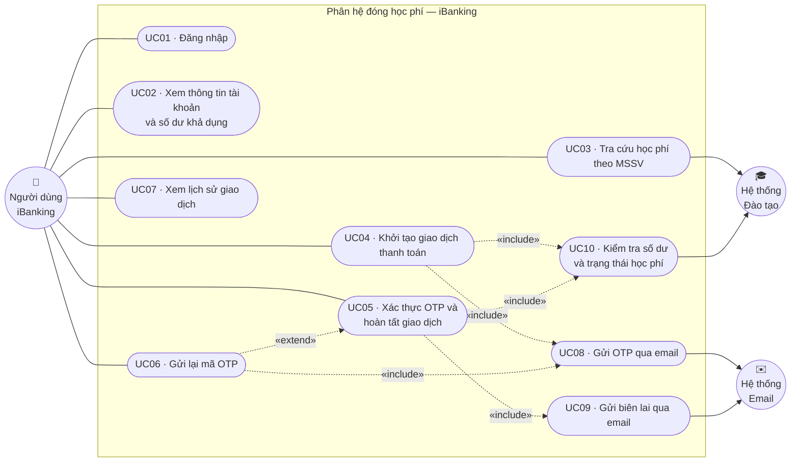
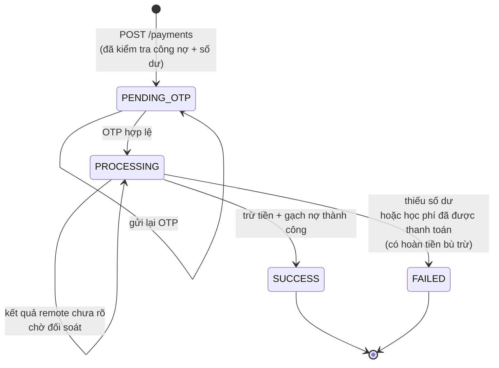
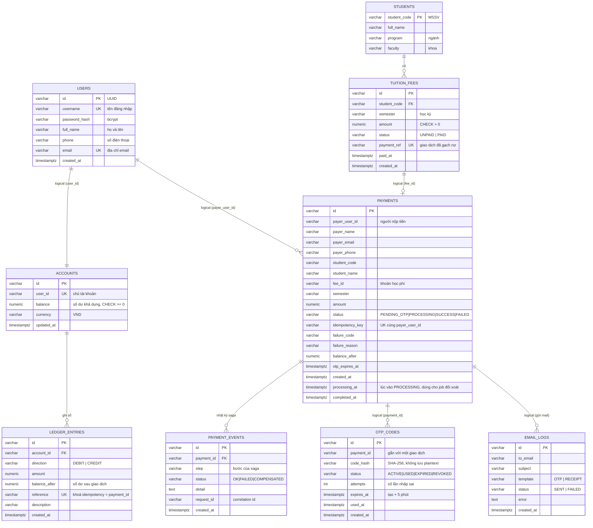

# 1. Phân tích nghiệp vụ và dữ liệu

> Phân hệ đóng học phí — ứng dụng iBanking (TDTU)
> Các sơ đồ viết bằng Mermaid: xem trực tiếp trên GitHub/VS Code, hoặc dán vào <https://mermaid.live> để xuất PNG/SVG chèn vào báo cáo.

---

## 1.1. Tác nhân (Actor)

| Tác nhân | Loại | Mô tả |
|---|---|---|
| **Người dùng iBanking** | Primary | Chủ tài khoản đã có sẵn trong hệ thống. Đăng nhập, tra cứu học phí và thanh toán cho chính mình **hoặc cho sinh viên khác**. |
| **Hệ thống Email (SMTP)** | Secondary / External | Nhận yêu cầu gửi mã OTP và biên lai giao dịch. Trong môi trường demo là MailHog. |
| **Hệ thống Quản lý đào tạo** | Secondary (mô phỏng) | Nguồn dữ liệu sinh viên và công nợ học phí. Ở đồ án được mô phỏng bằng `tuition-service` với dữ liệu mẫu + API admin. |

Đề bài **không yêu cầu** chức năng đăng ký tài khoản, nên không có tác nhân quản trị người dùng.

---

## 1.2. Use Case Diagram

### Đặc tả use case rút gọn

| Mã | Use case | Tiền điều kiện | Hậu điều kiện thành công |
|---|---|---|---|
| UC01 | Đăng nhập | Có tài khoản trong hệ thống | Nhận JWT, truy cập được chức năng thanh toán |
| UC02 | Xem thông tin tài khoản | Đã đăng nhập | Hiển thị họ tên, SĐT, email, số dư khả dụng |
| UC03 | Tra cứu học phí theo MSSV | Đã đăng nhập | Hiển thị thông tin sinh viên và khoản học phí còn nợ |
| UC04 | Khởi tạo giao dịch | UC03 trả về khoản nợ, số dư ≥ số tiền, đã đồng ý điều khoản | Tạo giao dịch `PENDING_OTP`, gửi OTP qua email |
| UC05 | Xác thực OTP, hoàn tất | Giao dịch `PENDING_OTP`, OTP còn hạn | Trừ tiền, gạch nợ học phí, ghi lịch sử, gửi biên lai |
| UC06 | Gửi lại OTP | Giao dịch `PENDING_OTP` | Mã cũ bị thu hồi, mã mới được gửi |
| UC07 | Xem lịch sử giao dịch | Đã đăng nhập | Danh sách giao dịch và biến động số dư |

### Đặc tả chi tiết — UC05 · Xác thực OTP và hoàn tất giao dịch

**Luồng chính**

1. Người dùng nhập mã OTP 6 chữ số và bấm *Xác nhận*.
2. Hệ thống kiểm tra OTP: đúng giao dịch, còn hạn, chưa sử dụng.
3. Hệ thống khoá giao dịch, chuyển trạng thái `PENDING_OTP → PROCESSING`.
4. Hệ thống kiểm tra lại số dư khả dụng và **trừ tiền** người nộp.
5. Hệ thống **gạch nợ** khoản học phí tương ứng.
6. Hệ thống ghi lịch sử giao dịch, chuyển trạng thái `SUCCESS`.
7. Hệ thống gửi email biên lai và hiển thị kết quả.

**Luồng thay thế / ngoại lệ**

| Mã | Tình huống | Xử lý |
|---|---|---|
| A1 | OTP sai | Từ chối, tăng số lần thử, còn tối đa 5 lần |
| A2 | OTP hết hạn (> 5 phút) | Từ chối, yêu cầu gửi lại mã (UC06) |
| A3 | OTP đã dùng | Từ chối — mã chỉ dùng được một lần |
| A4 | Nhập sai 5 lần | Khoá mã, buộc phát hành mã mới |
| A5 | Số dư không đủ tại bước 4 (do giao dịch song song) | Giao dịch `FAILED`, **không** chạm vào học phí |
| A6 | Học phí vừa được người khác thanh toán ở bước 5 | **Hoàn tiền** đã trừ ở bước 4, giao dịch `FAILED` |
| A7 | Gửi email biên lai lỗi | Giao dịch vẫn `SUCCESS`, ghi log lỗi gửi mail |
| A8 | Timeout/mất phản hồi khi trừ tiền, gạch nợ hoặc hoàn tiền | Giữ `PROCESSING`, chờ job đối soát đọc ledger/công nợ; không suy đoán thất bại từ lỗi mạng |

---

## 1.3. Sơ đồ trạng thái của giao dịch

---

## 1.4. Entity Relationship Diagram

Hệ thống theo kiến trúc microservices nên dữ liệu được tách theo **database-per-service**.
ERD dưới đây là **mô hình logic toàn phân hệ**; khung màu cho biết entity thuộc service nào.
Quan hệ **nét liền** là khoá ngoại thật trong cùng một database; quan hệ **in nghiêng ghi chú "logical"** là tham chiếu logic xuyên service (không có FK vật lý, đúng nguyên tắc service tự trị dữ liệu).

### Phân bổ entity theo service

| Database | Service sở hữu | Entity |
|---|---|---|
| `authdb` | auth-service | `USERS` |
| `accountdb` | account-service | `ACCOUNTS`, `LEDGER_ENTRIES` |
| `tuitiondb` | tuition-service | `STUDENTS`, `TUITION_FEES` |
| `paymentdb` | payment-service | `PAYMENTS`, `PAYMENT_EVENTS` |
| `otpdb` | otp-service | `OTP_CODES` |
| `notificationdb` | notification-service | `EMAIL_LOGS` |

### Ràng buộc dữ liệu quan trọng

| Ràng buộc | Kiểu | Mục đích nghiệp vụ |
|---|---|---|
| `accounts.balance >= 0` | CHECK | Chốt chặn cuối: không bao giờ chi vượt số dư |
| `ledger_entries.reference` | UNIQUE | Idempotency — một giao dịch chỉ ghi sổ một lần |
| `tuition_fees (student_code, semester)` | UNIQUE | Mỗi học kỳ một khoản học phí |
| `tuition_fees.payment_ref` | UNIQUE | Một giao dịch chỉ gạch nợ được một khoản |
| `tuition_fees.status IN ('UNPAID','PAID')` | CHECK | Không cho thanh toán một phần |
| `payments (payer_user_id, idempotency_key)` | UNIQUE | Chống tạo trùng giao dịch khi bấm nhiều lần |
| `payments.fee_id WHERE status='SUCCESS'` | UNIQUE (partial) | **Một khoản học phí chỉ có một giao dịch thành công** |
| `otp_codes.payment_id WHERE status='ACTIVE'` | UNIQUE (partial) | Mỗi giao dịch chỉ một OTP còn hiệu lực |
| `otp_codes.code_hash WHERE status='ACTIVE'` | UNIQUE (partial) | **OTP không trùng với OTP đang hiệu lực của giao dịch khác** |
