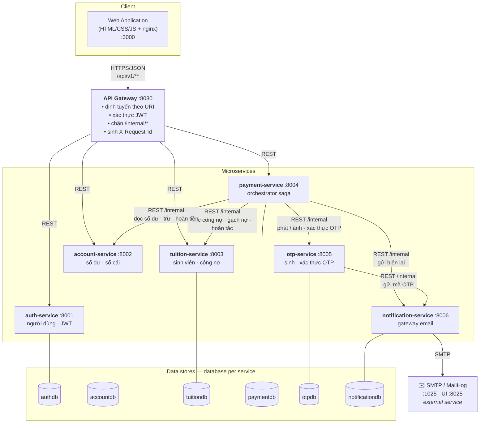
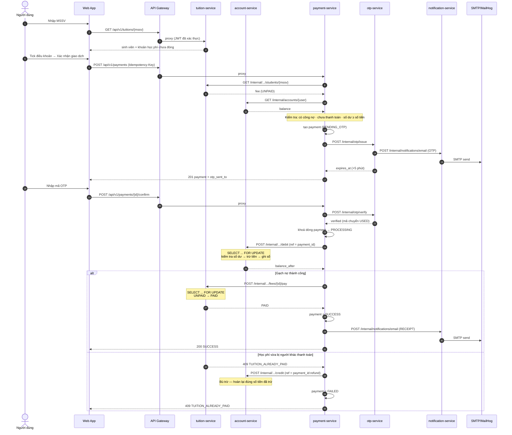
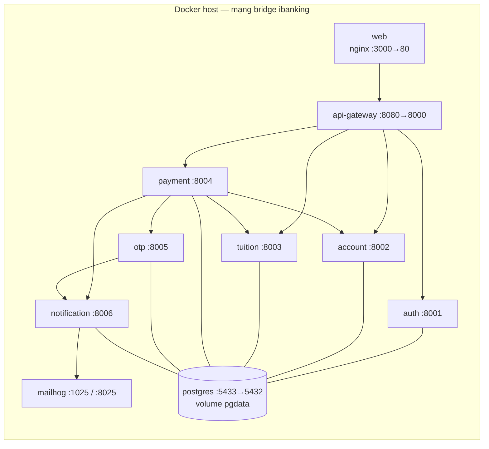

# 2. Thiết kế kiến trúc Microservices

---

## 2.1. Microservices Architecture Diagram

---

## 2.2. Phân rã service và trách nhiệm

| Service | Trách nhiệm (bounded context) | Sở hữu dữ liệu | KHÔNG làm |
|---|---|---|---|
| **api-gateway** | Điểm vào duy nhất; định tuyến theo tiền tố URI; xác thực JWT sớm; chặn endpoint `/internal/*`; sinh & truyền `X-Request-Id`; CORS | không có DB | Không chứa bất kỳ logic nghiệp vụ nào |
| **auth-service** | Xác thực username/password (bcrypt), phát hành JWT, cung cấp hồ sơ người dùng | `users` | Không giữ số dư |
| **account-service** | Số dư khả dụng, trừ/hoàn tiền **có khoá dòng**, sổ cái lịch sử giao dịch | `accounts`, `ledger_entries` | Không biết học phí là gì |
| **tuition-service** | Danh mục sinh viên, công nợ học phí, tra cứu theo MSSV, gạch nợ/huỷ gạch nợ | `students`, `tuition_fees` | Không biết tiền ở đâu ra |
| **payment-service** | **Orchestrator**: kiểm tra điều kiện, tạo giao dịch, điều phối OTP → trừ tiền → gạch nợ → biên lai, bù trừ khi lỗi, lưu saga trace | `payments`, `payment_events` | Không tự sửa số dư hay học phí |
| **otp-service** | Sinh OTP không trùng, gắn với giao dịch, hạn 5 phút, dùng một lần, đếm số lần sai | `otp_codes` | Không biết nghiệp vụ thanh toán |
| **notification-service** | Cổng ra duy nhất tới email; render template OTP/biên lai; nhật ký gửi mail | `email_logs` | Không sinh OTP |

**Nguyên tắc phân rã:** mỗi service là một *bounded context* có dữ liệu riêng và một lý do duy nhất để thay đổi.
Ví dụ đổi chính sách OTP (độ dài mã, thời hạn) chỉ động vào `otp-service`; đổi nhà cung cấp email chỉ động vào `notification-service`.

---

## 2.3. Giao tiếp giữa các service

Toàn bộ giao tiếp là **REST/JSON đồng bộ trên HTTP** trong mạng nội bộ Docker.

| Bên gọi | Bên nhận | Endpoint | Mục đích | Đồng bộ? |
|---|---|---|---|---|
| web | api-gateway | `/api/v1/**` | Mọi thao tác người dùng | ✔ |
| api-gateway | auth / account / tuition / payment | `/api/v1/**` | Proxy sau khi xác thực JWT | ✔ |
| payment-service | tuition-service | `GET /internal/tuitions/students/{mssv}` | Đọc công nợ để dựng giao dịch | ✔ |
| payment-service | account-service | `GET /internal/accounts/{user_id}` | Kiểm tra số dư trước khi gửi OTP | ✔ |
| payment-service | otp-service | `POST /internal/otp/issue` · `/verify` | Phát hành & xác thực OTP | ✔ |
| payment-service | account-service | `POST .../debit` · `.../credit` | Trừ tiền / **hoàn tiền bù trừ** | ✔ |
| payment-service | tuition-service | `POST .../fees/{id}/pay` · `/revert` | Gạch nợ / **huỷ gạch nợ bù trừ** | ✔ |
| payment-service | notification-service | `POST /internal/notifications/email` | Gửi biên lai (best-effort) | ✔ |
| otp-service | notification-service | `POST /internal/notifications/email` | Gửi mã OTP | ✔ |
| notification-service | SMTP (MailHog) | giao thức SMTP | Gửi email thật | ✔ |

**Bảo mật lời gọi nội bộ.** Endpoint `/internal/*` yêu cầu header `X-Internal-Token`; gateway từ chối mọi URI chứa `internal`, nên nhóm API này không thể chạm tới từ ngoài cluster.

**Truy vết.** `X-Request-Id` sinh ở gateway, truyền qua mọi lời gọi và ghi vào log JSON của tất cả service, đồng thời lưu vào bảng `payment_events`. Một giao dịch có thể tra cứu xuyên 4 service bằng một id duy nhất.

---

## 2.4. Sequence Diagram — luồng thanh toán đầy đủ

---

## 2.5. Giải thích các quyết định kiến trúc

### Vì sao phân rã như trên?
Ranh giới service bám theo **năng lực nghiệp vụ (business capability)**, không theo tầng kỹ thuật:
danh tính · tiền · công nợ · điều phối giao dịch · xác thực OTP · thông báo.
Đây cũng chính là ranh giới thay đổi trong thực tế ngân hàng (đổi core thẻ, đổi nhà cung cấp SMS/email, đổi hệ đào tạo) nên mỗi thay đổi chỉ ảnh hưởng một service.

### Vì sao database-per-service?
Không service nào biết connection string của service khác; muốn dữ liệu của nhau thì phải đi qua API. Nhờ vậy:
- lược đồ dữ liệu của một service thay đổi mà không làm vỡ service khác;
- không có join xuyên nghiệp vụ — tránh "monolith phân tán".

Demo dùng **một Postgres instance với 6 database riêng** thay vì 6 instance, để tiết kiệm tài nguyên máy chấm. Ranh giới logic vẫn nguyên vẹn và có thể tách thành 6 instance mà không sửa code (chỉ đổi `DATABASE_URL`).

### Vì sao REST đồng bộ, không dùng message broker?
Luồng thanh toán là **request–response có tính tương tác**: người dùng đứng chờ kết quả để biết giao dịch thành công hay không. Đồng bộ cho phép trả lỗi ngay và giữ code đơn giản.
Chỗ *nên* bất đồng bộ là gửi email — đã được cô lập trong `notification-service`, và lỗi gửi biên lai **không** làm hỏng giao dịch đã thành công. Khi cần chịu tải cao hơn, chỉ việc thay lời gọi HTTP tới notification bằng publish message, không đụng đến nghiệp vụ.

### Vì sao chọn orchestration saga thay vì choreography?
Giao dịch tài chính cần một nơi duy nhất trả lời được câu hỏi *"giao dịch này đang ở đâu, vì sao hỏng"*. `payment-service` giữ state machine và ghi `payment_events` cho từng bước; việc bù trừ (hoàn tiền) là tường minh, dễ demo và dễ audit. Choreography bằng event sẽ phân tán logic bù trừ ra nhiều service và rất khó giải thích khi bảo vệ đồ án.

### Vì sao có API Gateway?
- Client chỉ cần biết **một** địa chỉ, không phải 6 cổng.
- Xác thực JWT tập trung, fail-fast trước khi chạm tới nghiệp vụ.
- Là nơi duy nhất chặn `/internal/*` — biên giới an ninh rõ ràng.
- Nơi tự nhiên để cắm rate-limit, tracing, logging tập trung về sau.

Các service **vẫn tự verify JWT** (zero-trust) chứ không tin header do gateway gắn vào, phòng trường hợp ai đó gọi thẳng service trong mạng nội bộ.

### Đánh đổi đã chấp nhận (và hướng nâng cấp)

| Quyết định | Đánh đổi | Khi nào cần nâng cấp |
|---|---|---|
| REST đồng bộ cho saga | payment-service phụ thuộc tính sẵn sàng của 4 service | Tải cao → chuyển bước gửi mail sang message broker + outbox pattern |
| Một Postgres instance, 6 database | Vẫn là một điểm hỏng chung ở tầng hạ tầng | Production → tách instance/cluster riêng cho từng service |
| Bù trừ bằng hoàn tiền tức thì | Có khoảnh khắc tiền đã trừ nhưng chưa gạch nợ (< 1 giây) | Cần đảm bảo tuyệt đối → thêm job đối soát các payment `PROCESSING` treo |
| JWT dùng shared secret HS256 | Mọi service phải biết secret | Nhiều team → chuyển RS256, service chỉ giữ public key |
| Thư viện `common/` dùng chung | Thay đổi common ảnh hưởng nhiều service | Tách thành package versioned, mỗi service nâng cấp độc lập |

---

## 2.6. Deployment view

Mỗi service là **một container độc lập**, cùng một `Dockerfile` tham số hoá bằng `--build-arg SERVICE`.
`docker-compose.yml` khai báo `healthcheck` cho từng service và `depends_on: condition: service_healthy`, nên thứ tự khởi động luôn đúng: postgres → notification → otp → (account, tuition) → payment → gateway → web.
