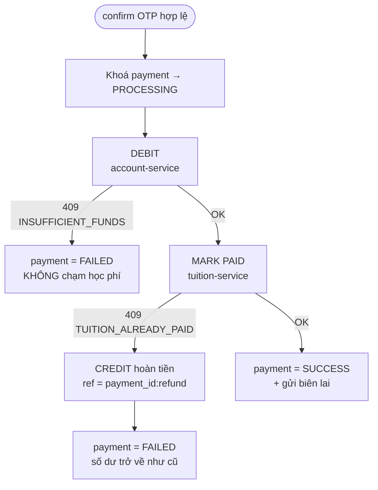

# 4. Xử lý Transaction và Concurrency

> Mục tiêu: sau khi giao dịch kết thúc, **số dư · trạng thái học phí · lịch sử giao dịch** phải phản ánh đúng một kết quả cuối cùng duy nhất, kể cả khi nhiều giao dịch chạy chồng lên nhau.

---

## 4.1. Hai tầng nhất quán

| Phạm vi | Cơ chế | Đảm bảo |
|---|---|---|
| **Trong một service** | Transaction ACID của PostgreSQL + `SELECT ... FOR UPDATE` + CHECK/UNIQUE constraint | Trừ tiền và ghi sổ là **nguyên tử**; gạch nợ học phí là **nguyên tử** |
| **Xuyên nhiều service** | **Saga có bù trừ** do `payment-service` điều phối, mọi bước **idempotent** | Không tồn tại trạng thái "đã trừ tiền nhưng học phí vẫn nợ" |

Không dùng two-phase commit (XA): khoá tài nguyên xuyên service trong suốt giao dịch làm giảm tính sẵn sàng và không service nào còn tự trị. Saga đánh đổi bằng *eventual consistency* trong khoảng dưới một giây, và sự bù trừ được ghi lại tường minh trong sổ cái.

---

## 4.2. Transaction cục bộ

### Trừ tiền — `account-service`

```python
# services/account-service/app/main.py
account = db.execute(
    select(Account).where(Account.user_id == user_id).with_for_update()   # ① khoá dòng
).scalar_one_or_none()

if existing := find_by_reference(db, req.reference):                      # ② idempotency
    return existing_result

if account.balance < amount:                                              # ③ kiểm tra trong khoá
    raise APIError(409, "INSUFFICIENT_FUNDS", ...)

account.balance -= amount                                                 # ④ trừ tiền
db.add(LedgerEntry(..., balance_after=account.balance, reference=req.reference))
db.commit()                                                               # ⑤ nhả khoá
```

- ① `SELECT ... FOR UPDATE` khoá **dòng tài khoản** tới khi commit. Giao dịch thứ hai trên cùng tài khoản bị chặn ở bước ① cho đến khi giao dịch đầu kết thúc, nên bước ③ luôn đọc số dư mới nhất — **không có read-modify-write race**.
- ② Kiểm tra `reference` ngay trong khoá: gọi lại cùng một giao dịch không trừ tiền lần hai.
- ⑤ Số dư và bút toán sổ cái được commit **cùng một transaction** → không bao giờ lệch nhau.

Ba lớp bảo vệ chồng lên nhau: **khoá dòng** (ngăn race) → **UNIQUE `reference`** (ngăn ghi trùng khi hai request cùng reference chạy song song) → **CHECK `balance >= 0`** (chốt chặn cuối ở tầng database, kể cả khi code sai).

### Gạch nợ học phí — `tuition-service`

```python
fee = db.execute(
    select(TuitionFee).where(TuitionFee.id == fee_id).with_for_update()
).scalar_one_or_none()

if fee.status == PAID:
    if fee.payment_ref == req.payment_ref:
        return idempotent_ok                      # chính giao dịch này retry
    raise APIError(409, "TUITION_ALREADY_PAID")   # giao dịch khác đã thắng

fee.status, fee.payment_ref, fee.paid_at = PAID, req.payment_ref, now()
db.commit()
```

Chuyển trạng thái `UNPAID → PAID` xảy ra **bên trong khoá dòng**, nên dù hai request vào cùng lúc, chỉ một request đọc được `UNPAID`.

### Mức cô lập (isolation level)

Dùng **READ COMMITTED** (mặc định của PostgreSQL) thay vì SERIALIZABLE:
mọi điểm tranh chấp đều đã được khoá tường minh bằng `FOR UPDATE`, nên không cần trả giá cho việc phải retry hàng loạt do lỗi serialization. Đây cũng là lựa chọn phổ biến trong hệ thống thanh toán thực tế.

---

## 4.3. Saga và bù trừ



**Vì sao trừ tiền trước, gạch nợ sau?** Tiền là tài nguyên khan hiếm và **có thể hoàn lại an toàn**; trạng thái học phí thì không nên bị "nhấp nháy" PAID → UNPAID trong mắt sinh viên. Nếu gạch nợ trước rồi trừ tiền lỗi, sẽ có khoảnh khắc học phí hiện "đã đóng" mà chưa ai trả tiền.

**Idempotency ở mọi bước:** `reference = payment_id` cho lệnh trừ tiền, `payment_ref = payment_id` cho lệnh gạch nợ, `reference = payment_id:refund` cho lệnh hoàn tiền. Retry do timeout mạng không tạo hiệu ứng phụ.

**Dấu vết kiểm toán:** mỗi bước ghi một dòng vào `payment_events` kèm `request_id`. Giao dịch thất bại có bù trừ để lại chuỗi `DEBIT(OK) → MARK_TUITION_PAID(FAILED) → REFUND(COMPENSATED)` — xem trực tiếp trên giao diện ở mục "Xem các bước xử lý".

---

## 4.4. Tình huống 5.1 — Nhiều giao dịch trên cùng một tài khoản

**Kịch bản:** số dư 13.000.000 ₫, hai giao dịch mỗi giao dịch 13.000.000 ₫ được xác nhận cùng lúc.

```mermaid
sequenceDiagram
    participant T1 as Giao dịch #1
    participant DB as accounts (row user X)
    participant T2 as Giao dịch #2

    T1->>DB: BEGIN; SELECT ... FOR UPDATE
    Note over DB: 🔒 khoá dòng
    T2->>DB: BEGIN; SELECT ... FOR UPDATE
    Note over T2: ⏳ bị chặn, phải chờ
    T1->>DB: balance(13tr) >= 13tr ✓ → balance = 0
    T1->>DB: INSERT ledger; COMMIT
    Note over DB: 🔓 nhả khoá
    DB-->>T2: balance = 0 (giá trị MỚI)
    T2->>DB: 0 >= 13tr ✗
    T2-->>T2: 409 INSUFFICIENT_FUNDS; ROLLBACK
```

**Kết quả bắt buộc:** đúng 1 giao dịch `SUCCESS`, 1 giao dịch `FAILED`, số dư cuối `= 0` và **không bao giờ âm**, chỉ 1 khoản học phí được gạch nợ.

Kiểm chứng tự động: `tests/test_03_concurrency.py::test_51_nhieu_giao_dich_tren_cung_mot_tai_khoan`.

---

## 4.5. Tình huống 5.2 — Nhiều tài khoản thanh toán cùng một khoản học phí

**Kịch bản:** hai người dùng khác nhau cùng đóng học phí cho một MSSV, xác nhận OTP cùng lúc.

```mermaid
sequenceDiagram
    participant A as Người dùng A
    participant ACC as account-service
    participant TUI as tuition_fees (row fee F)
    participant B as Người dùng B

    par Cả hai đều trừ tiền thành công (tài khoản khác nhau)
        A->>ACC: debit 1.000.000 ✓
    and
        B->>ACC: debit 1.000.000 ✓
    end

    A->>TUI: SELECT ... FOR UPDATE → UNPAID
    Note over TUI: 🔒 khoá dòng học phí
    B->>TUI: SELECT ... FOR UPDATE
    Note over B: ⏳ chờ
    A->>TUI: UNPAID → PAID (payment_ref = A); COMMIT
    TUI-->>B: status = PAID (của giao dịch A)
    B-->>B: 409 TUITION_ALREADY_PAID
    B->>ACC: credit 1.000.000 (ref = payment_B:refund)
    Note over B: 💰 hoàn tiền — số dư B trở về như trước
```

**Kết quả bắt buộc:** khoản học phí `PAID` đúng một lần với `payment_ref` của người thắng; người thua nhận `409 TUITION_ALREADY_PAID`, giao dịch `FAILED` và **số dư không đổi** nhờ bút toán hoàn tiền.

Lớp bảo vệ thứ hai ở `payment-service`: partial unique index `payments(fee_id) WHERE status='SUCCESS'` — dù logic ứng dụng có sai, database vẫn không cho phép hai giao dịch `SUCCESS` trên cùng một khoản học phí.

Kiểm chứng tự động: `tests/test_03_concurrency.py::test_52_nhieu_tai_khoan_thanh_toan_cung_mot_hoc_phi`.

---

## 4.6. Bảng tổng hợp cơ chế

| Rủi ro | Cơ chế chính | Cơ chế dự phòng |
|---|---|---|
| Chi tiêu vượt số dư | `SELECT ... FOR UPDATE` trên `accounts` | `CHECK balance >= 0` |
| Trừ tiền hai lần (retry/double-click) | `UNIQUE ledger_entries.reference` + kiểm tra trong khoá | `Idempotency-Key` ở `POST /payments` |
| Học phí bị thanh toán hai lần | `SELECT ... FOR UPDATE` trên `tuition_fees` | `UNIQUE payments(fee_id) WHERE status='SUCCESS'`, `UNIQUE tuition_fees.payment_ref` |
| Xác nhận OTP đồng thời cho một giao dịch | OTP dùng một lần (`ACTIVE → USED` trong khoá) | Khoá dòng `payments` + kiểm tra trạng thái `PENDING_OTP` |
| OTP trùng giữa các giao dịch | `UNIQUE otp_codes.code_hash WHERE status='ACTIVE'` | Sinh lại mã khi đụng ràng buộc |
| Tiền đã trừ nhưng gạch nợ lỗi | Bù trừ hoàn tiền ngay trong luồng | `payment_events` ghi `COMPENSATED` để đối soát |
| Brute-force OTP | Đếm `attempts`, khoá sau 5 lần | Mã chỉ sống 5 phút |

---

## 4.7. Cách chứng minh khi demo

```bash
# Chạy riêng bộ test đồng thời và xem kết quả
pytest tests/test_03_concurrency.py -v
```

Ngoài ra có thể quan sát trực tiếp:

1. Đặt `LOCK_HOLD_MS=150` trong `.env` (mặc định) để cửa sổ tranh chấp đủ rộng — khoá giữ lâu hơn, race chắc chắn xảy ra chứ không "may mà đúng".
2. Mở log của service để thấy thứ tự tuần tự hoá:
   ```bash
   docker compose logs -f account-service tuition-service payment-service
   ```
3. Trên giao diện, mở "Xem các bước xử lý (saga trace)" của giao dịch thất bại để thấy chuỗi `DEBIT → MARK_TUITION_PAID(FAILED) → REFUND(COMPENSATED)`.
4. Đối chiếu tab "Biến động số dư": người thua có đúng một dòng `−1.000.000` và một dòng `+1.000.000`.

> `LOCK_HOLD_MS` chỉ là khoảng `sleep` để *quan sát* tranh chấp; đặt `0` cho môi trường đo hiệu năng. Tính đúng đắn không phụ thuộc vào giá trị này.
