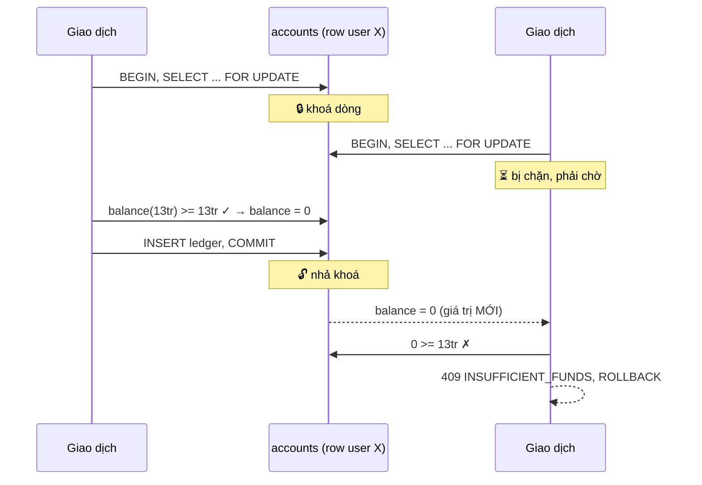
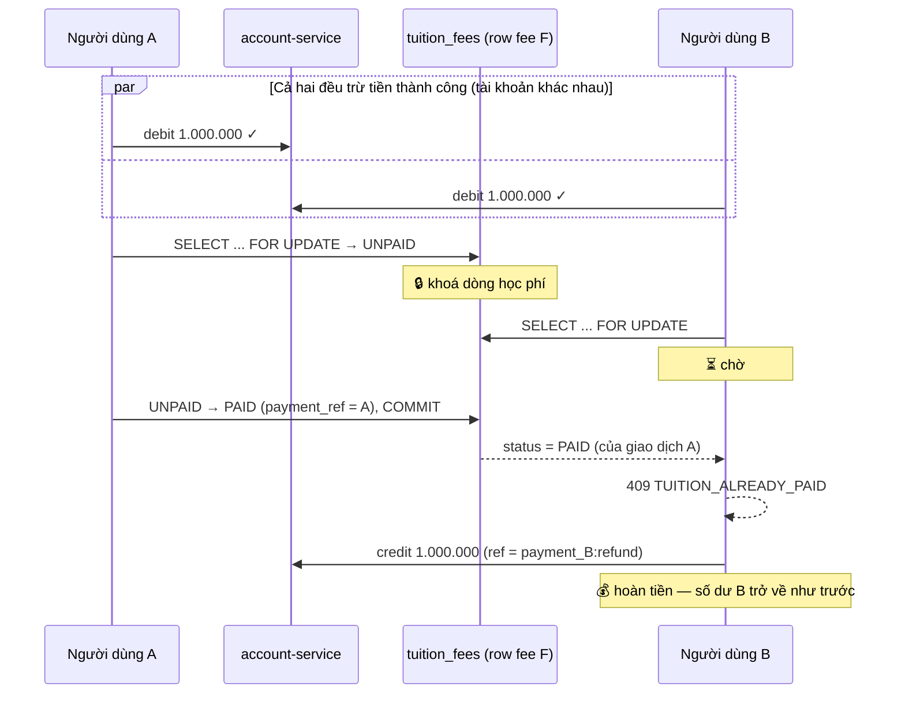

# 4. Xử lý Transaction và Concurrency

> Mục tiêu: sau khi giao dịch kết thúc, **số dư · trạng thái học phí · lịch sử giao dịch** phải phản ánh đúng một kết quả cuối cùng duy nhất, kể cả khi nhiều giao dịch chạy chồng lên nhau.

---

## 4.1. Hai tầng nhất quán

| Phạm vi | Cơ chế | Đảm bảo |
|---|---|---|
| **Trong một service** | Transaction ACID của PostgreSQL + `SELECT ... FOR UPDATE` + CHECK/UNIQUE constraint | Trừ tiền và ghi sổ là **nguyên tử**; gạch nợ học phí là **nguyên tử** |
| **Xuyên nhiều service** | **Saga có bù trừ** và job đối soát do `payment-service` điều phối, các bước ghi tiền idempotent | Hội tụ về kết quả nhất quán khi các dịch vụ phụ thuộc hoạt động trở lại; có trạng thái trung gian |

Không dùng two-phase commit (XA). Saga chấp nhận *eventual consistency*: tiền có thể đã trừ khi học phí chưa gạch nợ. Luồng bình thường thường nhanh, nhưng khi lỗi mạng hoặc tiến trình sập, thời gian phục hồi phụ thuộc ngưỡng đối soát và tính sẵn sàng của các service; không cam kết dưới một giây.

---

## 4.2. Transaction cục bộ

### Trừ tiền — `account-service`

```python
# services/account-service/app/main.py
account = db.execute(
    select(Account).where(Account.user_id == user_id).with_for_update()   # ① khoá dòng
).scalar_one_or_none()

if existing := replay_of(db, account, req, direction):                    # ② idempotency
    return existing_result

if account.balance < amount:                                              # ③ kiểm tra trong khoá
    raise APIError(409, "INSUFFICIENT_FUNDS", ...)

account.balance -= amount                                                 # ④ trừ tiền
db.add(LedgerEntry(..., balance_after=account.balance, reference=req.reference))
db.commit()                                                               # ⑤ nhả khoá
```

- ① `SELECT ... FOR UPDATE` khoá **dòng tài khoản** tới khi commit. Giao dịch thứ hai trên cùng tài khoản bị chặn ở bước ① cho đến khi giao dịch đầu kết thúc, nên bước ③ luôn đọc số dư mới nhất — **không có read-modify-write race**.
- ② Kiểm tra `reference` ngay trong khoá: gọi lại cùng một giao dịch không trừ tiền lần hai. `reference` là UNIQUE **toàn hệ thống**, nên chỉ coi là replay khi bút toán cũ trùng cả **tài khoản, chiều ghi nợ/ghi có và số tiền**; lệch bất kỳ yếu tố nào thì trả `409 REFERENCE_CONFLICT` thay vì báo thành công giả. Tra theo mỗi `reference` sẽ bắt trúng bút toán của tài khoản khác: job đối soát nhận `idempotent_replay` rồi chốt "đã hoàn tiền" cho một giao dịch thực tế chưa hề được hoàn.
- ⑤ Số dư và bút toán sổ cái được commit **cùng một transaction** → không bao giờ lệch nhau.

Ba lớp bảo vệ chồng lên nhau: **khoá dòng** (ngăn race) → **UNIQUE `reference`** (ngăn ghi trùng khi hai request cùng reference chạy song song) → **CHECK `balance >= 0`** (chốt chặn cuối ở tầng database, kể cả khi code sai).

### Gạch nợ học phí — `tuition-service`

```python
fee = db.execute(
    select(TuitionFee).where(TuitionFee.id == fee_id).with_for_update()
).scalar_one_or_none()

if fee.status == PAID:
    if fee.payment_ref == req.payment_ref:
        return idempotent_ok                      # chính giao dịch này retry
    raise APIError(409, "TUITION_ALREADY_PAID")   # giao dịch khác đã thắng

fee.status, fee.payment_ref, fee.paid_at = PAID, req.payment_ref, now()
db.commit()
```

Chuyển trạng thái `UNPAID → PAID` xảy ra **bên trong khoá dòng**, nên dù hai request vào cùng lúc, chỉ một request đọc được `UNPAID`.

### Mức cô lập (isolation level)

Dùng **READ COMMITTED** (mặc định của PostgreSQL) thay vì SERIALIZABLE:
mọi điểm tranh chấp đều đã được khoá tường minh bằng `FOR UPDATE`, nên không cần trả giá cho việc phải retry hàng loạt do lỗi serialization. Đây cũng là lựa chọn phổ biến trong hệ thống thanh toán thực tế.

---

## 4.3. Saga và bù trừ


**Vì sao trừ tiền trước, gạch nợ sau?** Tiền là tài nguyên khan hiếm và **có thể hoàn lại an toàn**; trạng thái học phí thì không nên bị "nhấp nháy" PAID → UNPAID trong mắt sinh viên. Nếu gạch nợ trước rồi trừ tiền lỗi, sẽ có khoảnh khắc học phí hiện "đã đóng" mà chưa ai trả tiền.

**Idempotency ở mọi bước:** `reference = payment_id` cho lệnh trừ tiền, `payment_ref = payment_id` cho lệnh gạch nợ, `reference = payment_id:refund` cho lệnh hoàn tiền. Retry do timeout mạng không tạo hiệu ứng phụ.

**Dấu vết kiểm toán:** mỗi bước ghi một dòng vào `payment_events` kèm `request_id`. Giao dịch thất bại có bù trừ để lại chuỗi `DEBIT(OK) → MARK_TUITION_PAID(FAILED) → REFUND(COMPENSATED)` — xem trực tiếp trên giao diện ở mục "Xem các bước xử lý".

---

## 4.4. Tình huống 5.1 — Nhiều giao dịch trên cùng một tài khoản

**Kịch bản:** số dư 13.000.000 ₫, hai giao dịch mỗi giao dịch 13.000.000 ₫ được xác nhận cùng lúc.



**Kết quả bắt buộc:** đúng 1 giao dịch `SUCCESS`, 1 giao dịch `FAILED`, số dư cuối `= 0` và **không bao giờ âm**, chỉ 1 khoản học phí được gạch nợ.

Kiểm chứng tự động: `tests/test_03_concurrency.py::test_51_nhieu_giao_dich_tren_cung_mot_tai_khoan`.

---

## 4.5. Tình huống 5.2 — Nhiều tài khoản thanh toán cùng một khoản học phí

**Kịch bản:** hai người dùng khác nhau cùng đóng học phí cho một MSSV, xác nhận OTP cùng lúc.



**Kết quả bắt buộc:** khoản học phí `PAID` đúng một lần với `payment_ref` của người thắng; người thua nhận `409 TUITION_ALREADY_PAID`, giao dịch `FAILED` và **số dư không đổi** nhờ bút toán hoàn tiền.

Lớp bảo vệ thứ hai ở `payment-service`: partial unique index `payments(fee_id) WHERE status='SUCCESS'` — dù logic ứng dụng có sai, database vẫn không cho phép hai giao dịch `SUCCESS` trên cùng một khoản học phí.

Kiểm chứng tự động: `tests/test_03_concurrency.py::test_52_nhieu_tai_khoan_thanh_toan_cung_mot_hoc_phi`.

---

## 4.6. Bảng tổng hợp cơ chế

| Rủi ro | Cơ chế chính | Cơ chế dự phòng |
|---|---|---|
| Chi tiêu vượt số dư | `SELECT ... FOR UPDATE` trên `accounts` | `CHECK balance >= 0` |
| Trừ tiền hai lần (retry/double-click) | `UNIQUE ledger_entries.reference` + kiểm tra trong khoá | `Idempotency-Key` ở `POST /payments` |
| Reference dùng lại cho bút toán khác | So khớp tài khoản + chiều + số tiền trước khi coi là replay → `409 REFERENCE_CONFLICT` | `UNIQUE ledger_entries.reference` chặn ghi trùng |
| Học phí bị thanh toán hai lần | `SELECT ... FOR UPDATE` trên `tuition_fees` | `UNIQUE payments(fee_id) WHERE status='SUCCESS'`, `UNIQUE tuition_fees.payment_ref` |
| Xác nhận OTP đồng thời cho một giao dịch | OTP dùng một lần (`ACTIVE → USED` trong khoá) | Khoá dòng `payments` + kiểm tra trạng thái `PENDING_OTP` |
| OTP trùng giữa các giao dịch | `UNIQUE otp_codes.code_hash WHERE status='ACTIVE'` | Sinh lại mã khi đụng ràng buộc |
| Tiền đã trừ nhưng gạch nợ lỗi | Bù trừ hoàn tiền ngay trong luồng | `payment_events` ghi `COMPENSATED` để đối soát |
| Brute-force OTP | Đếm `attempts`, khoá sau 5 lần | Mã chỉ sống 5 phút |

---

## 4.7. Giao dịch treo: job đối soát tự động

Saga chỉ tự bù trừ được **khi tiến trình còn sống**. Nếu `payment-service` bị giết đúng giữa bước trừ tiền và bước gạch nợ, giao dịch nằm lại ở `PROCESSING` với tiền đã trừ — không ai hoàn tác giúp.

`payment-service` chạy một **job đối soát nền** (`services/payment-service/app/reconciliation.py`) mỗi `RECONCILE_INTERVAL_SECONDS` (mặc định 30 giây). Job quét các giao dịch `PROCESSING` có `processing_at` cũ hơn `RECONCILE_STUCK_AFTER_SECONDS` (mặc định 60 giây — saga bình thường chạy dưới 1 giây), rồi **đọc lại sự thật từ hai service sở hữu dữ liệu** để quyết định:

| Học phí đã gạch nợ bởi chính giao dịch này? | Có bút toán trừ tiền? | Hành động | Kết quả |
|---|---|---|---|
| có | có | `COMPLETE` | Hoàn tất giao dịch → `SUCCESS` |
| có | không | `REVERT_AND_FAIL` | Huỷ gạch nợ → `FAILED` |
| không | có | `REFUND_AND_FAIL` | **Hoàn tiền** → `FAILED` |
| không | không | `FAIL` | Chỉ đóng giao dịch → `FAILED` |

Job còn đọc bút toán `payment_id:refund`. Nếu đã hoàn tiền thì không hoàn thêm và không kết luận `SUCCESS`; nếu khoản học phí vẫn thuộc giao dịch đã hoàn tiền, job huỷ gạch nợ đúng reference trước khi chốt `FAILED`. Bút toán phải thuộc đúng người nộp, đúng chiều ghi nợ/ghi có và đúng số tiền. Dữ liệu bất thường hoặc service không truy cập được được giữ lại để thử sau và kiểm tra vận hành.

Các cơ chế bảo vệ:

1. **Idempotent** — hoàn tiền dùng `reference = payment_id:refund`, huỷ gạch nợ dùng `payment_ref = payment_id`.
2. **Khoá xuyên phần xử lý** — foreground commit `PROCESSING` trước khi gọi debit, rồi lấy lại và giữ khóa dòng payment đến khi kết thúc phần thay đổi tiền. Job quét ID, khóa và kiểm tra lại từng dòng bằng `FOR UPDATE SKIP LOCKED`; trạng thái cuối và các event được commit cùng nhau. Helper ghi event chỉ flush, không nhả khóa ngầm.
3. **Không suy đoán từ timeout** — chỉ lỗi nghiệp vụ xác định mới chốt thất bại/bù trừ ngay. Mất phản hồi debit, gạch nợ hoặc hoàn tiền giữ `PROCESSING`: phía nhận có thể đã commit.
4. **Cô lập lỗi mỗi payment** — lỗi dependency/transaction rollback riêng, không ngăn job xử lý các ứng viên tiếp theo.

**Nâng cấp database đã có dữ liệu:** `Base.metadata.create_all()` chỉ tạo bảng còn thiếu, **không** thêm cột vào bảng đã tồn tại — chạy bản có `processing_at` trên một volume PostgreSQL cũ sẽ lỗi `UndefinedColumn` ở mọi truy vấn payment trong khi `/health` vẫn báo `UP`. `services/payment-service/app/migrations.py` chạy lúc khởi động, **trước** khi bật job đối soát: thêm cột, tạo index và backfill `processing_at = created_at` cho các giao dịch `PROCESSING` cũ. Thiếu backfill thì chúng mang giá trị `NULL`, nằm ngoài mọi so sánh `<` và treo vĩnh viễn ngoài tầm quét. Vì lý do đó bộ lọc quét dùng `coalesce(processing_at, created_at)`: dòng `NULL` do container bản cũ ghi *trong* lúc nâng cấp cuốn chiếu vẫn được đối soát. Các câu lệnh đều idempotent (`ADD COLUMN IF NOT EXISTS`, `CREATE INDEX IF NOT EXISTS`, `UPDATE ... WHERE processing_at IS NULL`) nên chạy lại mỗi lần khởi động vẫn sạch.

**Giới hạn:** giữ connection database trong lúc gọi HTTP phù hợp tải đồ án nhưng tốn pool khi dịch vụ chậm. Khi triển khai tải lớn cần cơ chế lease/fencing bền vững. Khóa tại payment-service không hủy được RPC đã gửi tới service khác trước khi crash; vì vậy ngưỡng 60 giây là khoảng chờ vận hành, không phải bảo đảm exactly-once với tác vụ remote trì hoãn vô hạn. Biên lai cho giao dịch được job hoàn tất chưa có outbox/retry tự động; trạng thái và sổ cái mới là nguồn xác nhận thanh toán.

Chạy thủ công một lượt (vận hành hoặc khi demo):

```bash
curl -s -X POST "http://localhost:8004/internal/payments/reconcile?stuck_after_seconds=0" \
     -H "X-Internal-Token: tdtu-soa-internal-token" | python3 -m json.tool
```

Kiểm chứng: `tests/test_04_reconciliation.py` dựng trạng thái crash bằng ledger/công nợ thật và ép `PROCESSING` trong database; kiểm tra refund/revert, idempotency, hai worker, khóa dòng và job nền. `tests/test_06_saga_recovery.py` kiểm tra mất phản hồi sau commit và service lỗi rồi phục hồi. Bảng quyết định được kiểm tra riêng ở mức hàm thuần trong `tests/unit/test_reconcile_decisions.py`. `tests/test_07_migration_and_idempotency.py` dựng lại schema cũ trong một schema PostgreSQL riêng rồi chạy đúng các câu lệnh migration thật (backfill, index, chạy lại lần hai), và kiểm tra reference bị dùng lại cho tài khoản / số tiền / chiều khác đều bị từ chối.

---

## 4.8. Cách chứng minh khi demo

```bash
# Chạy riêng bộ test đồng thời và xem kết quả
pytest tests/test_03_concurrency.py -v
```

Ngoài ra có thể quan sát trực tiếp:

1. Đặt `LOCK_HOLD_MS=150` trong `.env` (mặc định) để cửa sổ tranh chấp đủ rộng — khoá giữ lâu hơn, race chắc chắn xảy ra chứ không "may mà đúng".
2. Mở log của service để thấy thứ tự tuần tự hoá:
   ```bash
   docker compose logs -f account-service tuition-service payment-service
   ```
3. Trên giao diện, mở "Xem các bước xử lý (saga trace)" của giao dịch thất bại để thấy chuỗi `DEBIT → MARK_TUITION_PAID(FAILED) → REFUND(COMPENSATED)`.
4. Đối chiếu tab "Biến động số dư": người thua có đúng một dòng `−1.000.000` và một dòng `+1.000.000`.

> `LOCK_HOLD_MS` chỉ là khoảng `sleep` để *quan sát* tranh chấp; đặt `0` cho môi trường đo hiệu năng. Tính đúng đắn không phụ thuộc vào giá trị này.
