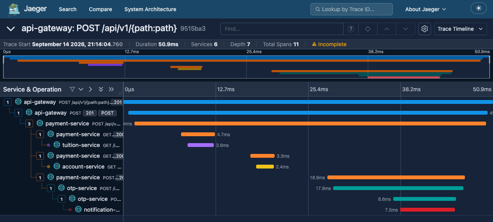
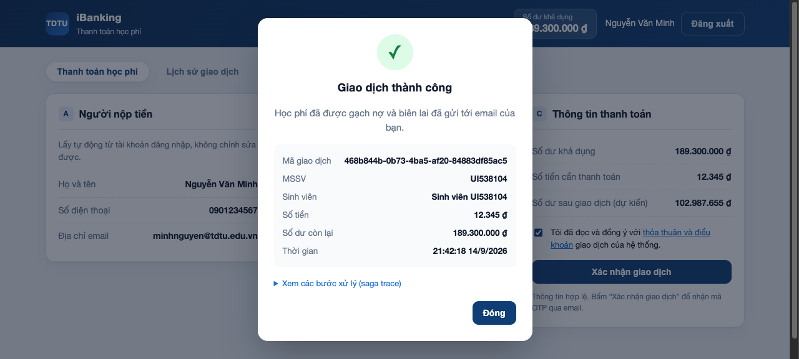

<!--
  BÁO CÁO ĐỒ ÁN GIỮA KỲ — KIẾN TRÚC HƯỚNG DỊCH VỤ (504070)
  File cấu trúc báo cáo: chứa trang bìa, lời mở đầu, các điểm include tài liệu 01..05, và kết luận.
-->

  

    
TRƯỜNG ĐẠI HỌC TÔN ĐỨC THẮNG

    
KHOA CÔNG NGHỆ THÔNG TIN

    

  

  

    <h1 class="cover-title">BÁO CÁO ĐỒ ÁN GIỮA KỲ</h1>
    <h2 class="cover-subtitle">504070 — Service-Oriented Architecture (Kiến trúc hướng dịch vụ)</h2>
    <h3 class="cover-topic">ĐỀ TÀI: PHÂN HỆ ĐÓNG HỌC PHÍ TRÊN ỨNG DỤNG IBANKING THEO KIẾN TRÚC MICROSERVICES</h3>
  

  

    <table class="cover-table">
      <tr>
        <td class="meta-label">Giảng viên hướng dẫn:</td>
        <td class="meta-val">Dương Hữu Phúc</td>
      </tr>
      <tr>
        <td class="meta-label">Sinh viên thực hiện:</td>
        <td class="meta-val">Nguyễn Hoàng Thanh Minh</td>
      </tr>
      <tr>
        <td class="meta-label">Mã số sinh viên:</td>
        <td class="meta-val">519H0194</td>
      </tr>
      <tr>
        <td class="meta-label">Mã nhóm:</td>
        <td class="meta-val"></td>
      </tr>
      <tr>
        <td class="meta-label">Học kỳ:</td>
        <td class="meta-val">HK1 / 2026–2027</td>
      </tr>
    </table>
  

  

    
TP. HỒ CHÍ MINH, 2026

  

# LỜI MỞ ĐẦU

Trong bối cảnh chuyển đổi số giáo dục đại học và tài chính số phát triển nhanh chóng, việc số hóa các dịch vụ tiện ích sinh viên ngày càng đóng vai trò quan trọng. Đồ án môn học **Kiến trúc hướng dịch vụ (504070)** tập trung hiện thực **Phân hệ đóng học phí trên ứng dụng iBanking**, mô phỏng nghiệp vụ tài chính thực tế giữa Ngân hàng và Nhà trường.

Hệ thống được thiết kế hoàn toàn theo mô hình **Microservices Architecture**, phân rã thành các dịch vụ nghiệp vụ chuyên biệt: `auth-service`, `account-service`, `tuition-service`, `payment-service`, `otp-service`, `notification-service`, cùng với thành phần điều phối `api-gateway` và giao diện người dùng `web-client`. Mỗi dịch vụ quản lý cơ sở dữ liệu riêng biệt (Database per Service), trao đổi qua REST API và đảm bảo tính nhất quán dữ liệu phân tán bằng mẫu hình **Saga Orchestration** với cơ chế bù trừ giao dịch (Compensating Transaction) và Idempotency.

Báo cáo này tổng hợp đầy đủ thiết kế phân tích nghiệp vụ, kiến trúc kỹ thuật, quy chuẩn API, giải pháp giao dịch phân tán và hướng dẫn vận hành hệ thống.

<!-- INCLUDE: 01-phan-tich-nghiep-vu.md -->

<!-- INCLUDE: 02-kien-truc-microservices.md -->

<!-- INCLUDE: 03-thiet-ke-rest-api.md -->

<!-- INCLUDE: 04-transaction-concurrency.md -->

<!-- INCLUDE: 05-huong-dan-su-dung-va-demo.md -->

# 6. Kiểm thử và minh chứng thực nghiệm

## 6.1. Môi trường và kết quả

Ngày kiểm chứng: 14/09/2026. Backend chạy Python 3.11 trong Docker Compose, PostgreSQL 16, Jaeger 2.20.0; bộ kiểm thử chạy bằng Python 3.11.15 và pytest 8.3.4.

Lệnh chạy: `python3.11 -m pytest -q --junitxml=docs/report-assets/test-results.xml` trong môi trường đã cài `tests/requirements.txt`.

**Kết quả toàn bộ: 88 passed, 1 skipped trong 53,25 giây.** Một cảnh báo deprecation của Starlette/AnyIO, không phải lỗi nghiệp vụ. File JUnit `report-assets/test-results.xml` lưu kết quả từng test. Test skipped kiểm tra OTP hết hạn, tách riêng để không phải đợi 300 giây trong mỗi lần chạy. Lượt riêng với `OTP_TTL_SECONDS=8` đạt **1 passed trong 10,46 giây** (`report-assets/test-otp-expiry.xml`); sau đó đã khôi phục và kiểm tra TTL **300 giây** trong container. Như vậy tất cả 89 ca đã được thực thi thành công qua hai cấu hình, không phải 89 ca pass trong một lượt chạy.

| Nhóm | Số ca | Kiểm chứng |
|---|---:|---|
| Unit | 42 | JWT, OTP, email, bảng đối soát, span/log và HTTPX sync/async |
| Payment integration/E2E | 11 | Phân quyền, công nợ, idempotency, số dư, biên lai |
| OTP integration | 7 | Sáu ca pass ở TTL 300 giây; ca hết hạn chạy riêng |
| Concurrency | 3 | Hai tình huống đề bài, xác nhận trùng |
| Đối soát | 15 | Crash state, refund/revert, worker đồng thời, khóa, job nền |
| Jaeger | 1 | Trace qua sáu service và parent-child |
| Saga recovery | 5 | Mất phản hồi sau commit, dependency lỗi rồi phục hồi |
| Nâng cấp schema và idempotency sổ cái | 5 | Migration `processing_at` trên database cũ; reference dùng lại sai tài khoản/số tiền/chiều |

**Tách unit khỏi Docker:** cả `pytest tests/unit` và `pytest -m unit` chạy được với `GATEWAY_URL=http://127.0.0.1:1`. Test pyramid phân biệt theo phạm vi và tốc độ, không coi số lượng ca là chứng minh đầy đủ chất lượng. Database và khóa trong các test concurrency/recovery là PostgreSQL thật; chỉ adapter HTTP được chèn lỗi sau thao tác remote đã commit.

## 6.2. Truy vết phân tán

Trace minh chứng: `9515ba3ab0b54e8cbb878d91214fb7e1`, request tạo giao dịch qua gateway. Kiểm thử xác nhận cùng trace ID ở gateway, payment, account, tuition, otp và notification; cạnh parent-child nối đúng các lời gọi. JSON access log của gateway/payment/OTP khớp ID này. Đây là một mẫu quan sát, không phải benchmark hiệu năng.

Jaeger dùng bộ nhớ nên trace ID không còn tra cứu được sau khi container restart. Ảnh và kết quả test lưu lại làm minh chứng.

## 6.3. Giao diện và luồng sử dụng

Kiểm tra trên trình duyệt với khoản học phí riêng `UI538104`: đăng nhập, tra cứu, đồng ý điều khoản, tạo giao dịch, lấy OTP MailHog, xác nhận 12.345 đồng, xem lịch sử và kiểm tra không thể đóng lại cùng khoản nợ. Mã thanh toán: `468b844b-0b73-4ba5-af20-84883df85ac5`. Không có lỗi JavaScript được ghi nhận trong luồng này.

## 6.4. Phạm vi chứng minh

Mô phỏng crash dùng trạng thái ledger/công nợ/payment thật tại các điểm gián đoạn; không phải thử nghiệm cắt điện máy chủ. Test response-loss gọi thao tác remote thật rồi ném lỗi thay cho phản hồi. Các ca chứng minh cơ chế ở phạm vi kiểm thử, không chứng minh exactly-once dưới mọi phân hoạch mạng hoặc chịu tải production. Unit test chưa đo coverage theo dòng/nhánh; tỷ lệ pass không đồng nghĩa 100% coverage.

# KẾT LUẬN VÀ HƯỚNG PHÁT TRIỂN

## Kết quả đạt được

Hệ thống mô phỏng luồng thanh toán học phí và các yêu cầu transaction/concurrency của đề bài:

1. **Microservices**: Sáu service nghiệp vụ, API Gateway và web frontend; mỗi service nghiệp vụ sở hữu một database trong PostgreSQL và trao đổi qua REST.
2. **Saga và phục hồi**: `payment-service` điều phối OTP, debit, gạch nợ, hoàn tiền và lưu trạng thái. Job nền đọc lại ledger/công nợ để xử lý `PROCESSING` sau gián đoạn, không suy đoán kết quả remote từ timeout. Migration lúc khởi động thêm và backfill `processing_at`, nên nâng cấp trên database đã có dữ liệu không làm mất dấu các giao dịch đang treo.
3. **Concurrency**: Khóa dòng PostgreSQL `SELECT ... FOR UPDATE`, `SKIP LOCKED`, CHECK/UNIQUE constraint và idempotency theo reference. Vì `reference` là UNIQUE toàn hệ thống, replay chỉ được công nhận khi trùng cả tài khoản, chiều và số tiền; lệch thì trả `409 REFERENCE_CONFLICT` thay vì báo hoàn tiền thành công sai. Hệ thống không dùng Redis, Redlock hay khóa phân tán trong bộ nhớ.
4. **Bảo mật và truy vết**: JWT tại gateway và các service, token nội bộ, OTP băm SHA-256 với pepper và hạn dùng 5 phút. OpenTelemetry FastAPI/HTTPX xuất span sang Jaeger; correlation ID cùng trace ID/span ID hỗ trợ truy tìm qua log.

Các giới hạn vận hành được nêu ở chương 4: nhất quán cuối cùng, connection giữ trong phần saga, remote RPC chưa có fencing, Jaeger lưu trong bộ nhớ và biên lai chưa có outbox. Đây là mô hình đồ án, không phải chứng nhận hệ thống ngân hàng production.

## Hướng phát triển

- Tích hợp Message Broker (Apache Kafka / RabbitMQ) để chuyển đổi từ HTTP Saga sang Event-Driven Saga cho các tác vụ bất đồng bộ quy mô lớn.
- Bổ sung Outbox Pattern kết hợp Debezium CDC để giải quyết triệt để dual-write giữa database và message broker.
- Mở rộng phân hệ đối soát tự động hàng ngày (End-of-day Reconciliation) đối chiếu sổ cái giữa Ngân hàng và Trường đại học.

# TÀI LIỆU THAM KHẢO

Các tài liệu kỹ thuật được đối chiếu ngày 14/09/2026:

1. PostgreSQL Global Development Group. *PostgreSQL 16 — Explicit Locking*: khóa dòng, `SELECT FOR UPDATE` và thời điểm giải phóng khóa. <https://www.postgresql.org/docs/16/explicit-locking.html>.
2. OpenTelemetry. *Manual instrumentation for OpenTelemetry Python*: `TracerProvider`, span, processor và exporter. <https://opentelemetry.io/docs/languages/python/instrumentation/>.
3. Chris Richardson. *Pattern: Saga*: local transaction, orchestration và compensating transaction. <https://microservices.io/patterns/data/saga.html>.

Minh chứng của hiện thực nằm trong mã nguồn, bộ kiểm thử `tests/` và các file JUnit/ảnh tại `docs/report-assets/`; tài liệu tham khảo mô tả mẫu thiết kế, không thay thế kiểm chứng hệ thống.
